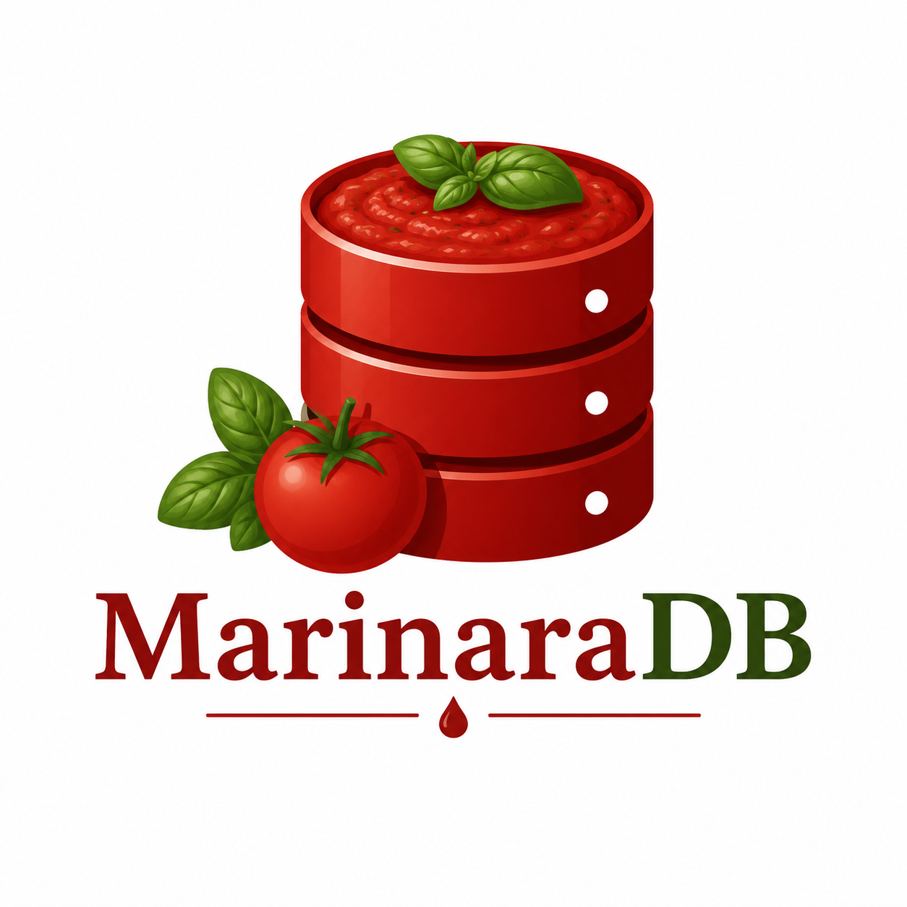

<p align="center">
  
</p>

# MarinaraDB

> *A relational database that's been simmering on the stove all day.*

MarinaraDB is a small relational database written from scratch in Rust: a paged on-disk file format, a write-ahead log with crash recovery, a SQL-style parser, a query planner and an executor, plus an interactive shell. The query language is called **SaucQL**. It has real SQL semantics and deliberately silly pasta syntax.

It's a learning project, not a production database. The point is to build every layer of a database by hand and keep each one small enough to read.

```text
marinara> SERVE name, price FROM dishes STRAINED BY vegetarian = 1 ARRANGED BY price DESC ONLY 3;
name                   | price
-----------------------|------
Quattro Formaggi Pizza | 15.5
Fettuccine Alfredo     | 15
Penne all'Arrabbiata   | 14
```

## Try it

You need a [Rust toolchain](https://rustup.rs). Then load the sample restaurant data (18 customers, 18 dishes, 40 orders) and open the shell:

```sh
git clone https://github.com/josh-spratt/marinaraDB
cd marinaraDB
cargo run -- trattoria.pot < examples/trattoria_seed.sauql
cargo run -- trattoria.pot
```

```text
marinara> .tables
customers
dishes
orders
marinara> SERVE customer_id, COUNT(*) FROM orders BUNDLED BY customer_id ARRANGED BY customer_id ONLY 3;
```

End each statement with `;`. Shell commands: `.tables`, `.help`, `.quit`. A statement that fails prints its error and the session carries on. Run `cargo run` with no path to open `marinara.pot` in the current directory.

## SaucQL in a minute

| SaucQL | SQL |
|---|---|
| `PLATE noodle t (...)` / `TOSS OUT noodle t` | `CREATE TABLE` / `DROP TABLE` |
| `LADLE INTO t (cols) PORTIONS (...)` | `INSERT INTO ... VALUES` |
| `SERVE cols FROM t` | `SELECT cols FROM t` |
| `STRAINED BY expr` | `WHERE expr` |
| `SEASON t SET col = x` | `UPDATE t SET col = x` |
| `DISCARD FROM t` | `DELETE FROM t` |
| `TOSS u ON a = b` | `INNER JOIN u ON a = b` |
| `ARRANGED BY` / `ONLY n` / `SKIP n` | `ORDER BY` / `LIMIT n` / `OFFSET n` |
| `BUNDLED BY` | `GROUP BY` (with `COUNT`, `SUM`, `AVG`, `MIN`, `MAX`) |
| `NOT VUOTO` / `IS VUOTO` | `NOT NULL` / `IS NULL` |

```sql
PLATE noodle users (name TEXT NOT VUOTO, age INT);
LADLE INTO users (name, age) PORTIONS ('Tony', 38), ('Maria', 29);
SEASON users SET age = 39 STRAINED BY name = 'Tony';
SERVE name, age FROM users STRAINED BY age > 30;
```

Conditions support comparisons, `AND` / `OR` / `NOT`, `BETWEEN`, `LIKE`, `IN` and three-valued `VUOTO` logic. Every table gets an auto-incrementing `id` (the **Al Dente Key**). Column types are `INT`, `REAL`, `TEXT` and `BLOB`.

The pasta vocabulary carries through the codebase: a database is a **Pot**, a table a **Noodle**, a row a **Strand**, an index a **Strainer**, the write-ahead log the **Prep Log**, and an error a **Scottatura**. The full glossary and grammar are in [SPEC.md](SPEC.md).

## How it works

A statement travels through these layers, each in its own module under `src/`:

```text
SaucQL text → parser → sous_chef (planner) → stove (executor)
                                                  ↓
                          prep_log (WAL) ← → warming_tray (page cache) ← → .pot file
```

- **`parser`**: a hand-written recursive-descent parser that turns SaucQL into a syntax tree.
- **`sous_chef`**: plans a parsed statement and rejects anything not yet supported with a clear error.
- **`stove`**: executes plans against heap storage, which chains 4 KB pages with CRC32 checksums.
- **`prep_log`**: a write-ahead log. Changes are written and synced to the log before the `.pot` file is touched, and recovery replays the log on every open.
- **`strainer`**: B-tree indexes (not wired up yet, see below).

Design notes for each layer are in [`docs/`](docs): [storage format](docs/storage-format.md), [WAL format](docs/wal-format.md), [SQL semantics](docs/sql-semantics.md), [type system](docs/type-system.md), [error taxonomy](docs/error-taxonomy.md) and [testing strategy](docs/testing-strategy.md).

## Use it as a library

Add `marinaradb` as a path dependency, then:

```rust
use marinaradb::Pot;

let mut pot = Pot::open("my_app.pot")?;
pot.execute("PLATE noodle users (name TEXT NOT VUOTO, age INT);")?;
pot.execute("LADLE INTO users (name, age) PORTIONS ('Tony', 38), ('Maria', 29);")?;

let result = pot.execute("SERVE name, age FROM users STRAINED BY age > 30;")?;
for row in &result.rows {
    println!("{row:?}");
}
```

There's also a lower-level API (`Pot::create_table`, `insert_strand`, `scan_noodle`) that skips the parser.

## Status

Working today: tables, inserts, updates and deletes, `WHERE` expressions, a single inner join per query, ordering, limits, grouping and aggregates, persistence across restarts, and write-ahead logging with crash recovery. There are over 200 tests (`cargo test`).

Not yet working:

- **Transactions** (`BEGIN SIMMER` / `FINISH SIMMER` / `SPILL SIMMER`) parse but return a clear error when run.
- **Indexes** (`STRAIN` / `REMOVE STRAINER`) parse but aren't executable. Queries use full scans.
- **Foreign keys** aren't enforced.
- `ARRANGED BY` can only sort by a column in the query's own `SERVE` list, and `BUNDLED BY` takes one bare column name, so you can't yet group a join by a column that exists in both tables.
- Table creation and drops aren't logged in the Prep Log yet. See [CHANGELOG.md](CHANGELOG.md) for the full list of known limits.

## Contributing and releases

This is a personal project, but issues are welcome. Versions follow [Semantic Versioning](https://semver.org), with `Cargo.toml` as the source of truth. To release, bump the version, add a dated section to [CHANGELOG.md](CHANGELOG.md), commit, tag `vX.Y.Z` and push the tag.

## License

[MIT](LICENSE)
